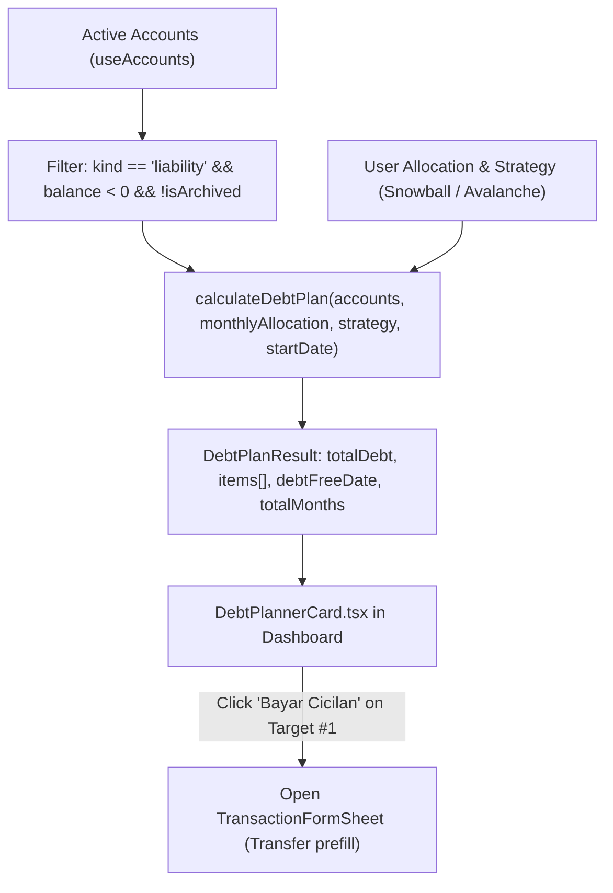

# Debt Snowball & Avalanche Planner Design Spec

**Date:** 2026-10-19  
**Status:** Approved  
**Author:** AI Agent & User  

---

## 1. Overview & Business Value

Many users accumulate liabilities across multiple services (credit cards, bank loans, and PayLater platforms like CIMB Niaga CC, CIMB Niaga KTA, TikTok PayLater, Shopee PayLater, and BCA CC). Managing multiple debts is stressful, and users often don't know which debt to pay off first or how long it will take to become completely debt-free.

The **Debt Snowball & Avalanche Planner** provides:
1. **Clear Visualization:** Aggregate total debt across all liability accounts.
2. **Actionable Methodologies:**
   - **Debt Snowball:** Prioritizes debts with the smallest balances first to generate rapid psychological wins and momentum.
   - **Debt Avalanche:** Prioritizes higher-cost debts (PayLater & KTA personal loans with high daily fees/interest before credit cards) to minimize total interest paid.
3. **Rollover Payoff Simulator:** Demonstrates how rolling over freed-up payments from cleared debts exponentially accelerates paying off remaining debts.
4. **1-Click Settlement:** Quick action on the active target to initiate a transfer transaction directly from a liquid asset account to the liability account.

---

## 2. Architecture & Data Flow



---

## 3. Detailed Component & Service Specifications

### 3.1 Domain Logic (`src/lib/debtPlanner.ts`)

#### Types:
```typescript
export type DebtStrategy = 'snowball' | 'avalanche';

export interface DebtPlanItem {
  accountId: string;
  name: string;
  icon?: string;
  initialDebt: number; // Positive absolute nominal
  payoffMonths: number;
  payoffDate: Date;
  payoffDateLabel: string; // e.g., "Maret 2027 (5 bln)"
  isCurrentFocus: boolean;
}

export interface DebtPlanResult {
  totalDebt: number;
  monthlyAllocation: number;
  strategy: DebtStrategy;
  totalMonths: number;
  debtFreeDate: Date | null;
  debtFreeDateLabel: string; // e.g., "Agustus 2027 (10 Bulan)"
  items: DebtPlanItem[];
}
```

#### Core Functions:
1. `getLiabilityAccountsWithDebt(accounts: Account[]): Account[]`
   - Filters accounts where `kind === 'liability' && balance < 0 && !isArchived`.
2. `sortDebtsByStrategy(debts: Account[], strategy: DebtStrategy): Account[]`
   - **Snowball:** Ascending by `Math.abs(balance)`. Smallest debt first.
   - **Avalanche:** Priority weighting based on debt type (PayLater & KTA loans first, then CCs, then other liabilities), followed by descending balance.
3. `calculateDebtPlan(accounts: Account[], monthlyAllocation: number, strategy: DebtStrategy, startDate: Date = new Date()): DebtPlanResult`
   - Handles edge cases:
     - `accounts.length === 0` or all balances `0` -> returns `totalDebt: 0`, `totalMonths: 0`, `debtFreeDate: null`.
     - `monthlyAllocation <= 0` -> defaults to minimum meaningful pace (e.g. 500,000 IDR) to prevent infinite loops.
   - Simulation loop:
     - Models month-by-month payment distribution where allocation is focused on Target #1 until exhausted, then cascades to Target #2.
     - Computes completion month for each account and overall debt-free date.

---

### 3.2 UI Component (`src/features/dashboard/DebtPlannerCard.tsx`)

#### Features & Layout:
1. **Header Section:**
   - Title: `🛡️ Rencana Bebas Hutang`
   - Total Debt Badge: Displays formatted Rupiah (e.g. `Total: Rp 15.000.000`).
2. **Strategy Selector:**
   - Segmented toggle pills:
     - `Snowball (Saldo Terkecil)`
     - `Avalanche (Bunga & Biaya)`
3. **Monthly Pay Allocation Presets:**
   - Quick pills: `Rp 500rb`, `Rp 1 Jt`, `Rp 2 Jt`, `Rp 5 Jt`, plus custom input option.
   - Projection Banner: `🏁 Target Bebas Hutang: [Bulan Tahun] ([N] Bulan Lagi)` with motivational badge.
4. **Step-by-Step Target Queue:**
   - **Target #1 (Focus Utama):** Highlighted card with glowing accent border, showing current debt, estimated payoff month, and a **"Bayar Cicilan"** action button.
   - **Upcoming Targets (#2, #3, ...):** Queued items showing expected payoff timeline.
5. **Zero-Debt State:**
   - When all liability balances are 0:
     - Celebration card: `🎉 Selamat! Anda bebas dari semua catatan hutang.`

---

### 3.3 Integration with Dashboard (`DashboardView.tsx`)

Placed directly below `UpcomingBillsCard.tsx` on the main dashboard screen:
- Passed props: `accounts: Account[]`, `onPayDebt: (targetAccountId: string, suggestedAmount: number) => void`.
- When clicking "Bayar Cicilan":
  - Triggers the existing `handleOpenTransfer(fromAccount, targetAccount, suggestedAmount)` logic in `DashboardView.tsx`.

---

## 4. Design System Compliance & Quality Gates

1. **Zero Raw Hex (Gate 12):**
   - All styles in `src/styles/components.css` must only use semantic CSS variables:
     - `var(--surface-card)`, `var(--surface-secondary)`, `var(--border-subtle)`, `var(--accent-primary)`, `var(--success-fg)`, `var(--text-primary)`, `var(--text-muted)`.
2. **Contrast Standards (WCAG AA):**
   - Normal text >= 4.5:1, bold/large text >= 3:1 in both light and dark (`data-theme="dark"`).
3. **Testing Requirements:**
   - Unit tests in `src/lib/debtPlanner.test.ts` covering:
     - Zero liability accounts
     - Snowball ordering & Avalanche ordering
     - Rollover calculation math accuracy
     - Zero allocation / invalid input handling
   - 100% green test suite across all 14 E2E gates and 37 unit tests.
