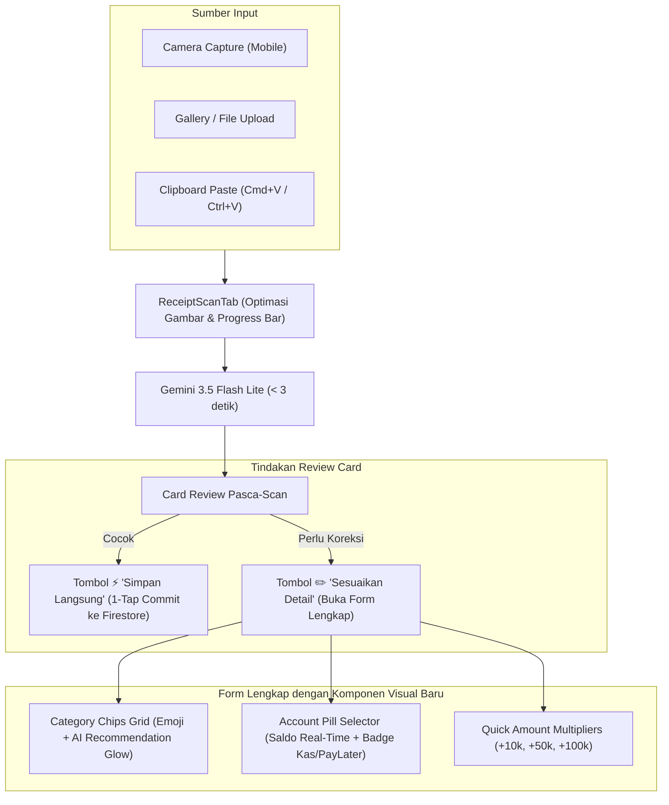

# Spesifikasi Desain: Intelligent Digital Receipt Autofill & Modern Input UI/UX

**Tanggal:** 2026-10-19  
**Status:** Approved by User / Ready for Implementation Planning  
**Target Rilis:** Phase 1 (Input Flow & Data Normalization)  
**Author:** Antigravity & User  

---

## 1. Ringkasan & Tujuan (Executive Summary)

Pengguna aplikasi Catat sering melakukan transaksi digital di berbagai ekosistem e-commerce dan fintech Indonesia:
- **Food Delivery:** ShopeeFood, GoFood
- **PayLater / Cicilan:** Shopee Paylater (SPayLater), TikTok Paylater, GoPay Later
- **Perbankan Digital & QRIS:** Bank Jago (transfer, kantong, QRIS), BCA, dll.

### Masalah Utama Saat Ini:
1. **OCR Kurang Kontekstual:** Model OCR saat ini hanya mengekstrak `amount`, `date`, dan `merchant` tanpa mengetahui daftar kategori atau akun yang dimiliki pengguna. Kategori dan akun harus dipilih manual dari dropdown.
2. **UI/UX Input Kaku:** Form transaksi masih menggunakan HTML `<select>` dropdown konvensional yang tidak ramah sentuhan, tidak menampilkan icon kategori, dan tidak memperlihatkan saldo akun secara instan.
3. **Flow Pasca-Scan Terputus:** Setelah scan struk selesai, user langsung dilempar ke form manual biasa dengan notifikasi teks kecil, tanpa adanya tinjauan visual (*Review Card*) yang memungkinkan konfirmasi cepat dalam 1 tap.
4. **Input Screenshot Repot di Desktop:** Belum mendukung paste gambar langsung dari clipboard (`Cmd+V` / `Ctrl+V`).

### Sasaran Desain (Goals):
- **Smart Category & Account Autofill:** AI (Gemini 3.5 Flash Lite) mencocokkan struk langsung ke `categoryId` dan `accountId` pengguna.
- **Card Review Pasca-Scan (1-Tap Confirm):** Menampilkan ringkasan hasil scan beserta thumbnail struk dengan tombol "Simpan Langsung" atau "Sesuaikan Detail".
- **Visual Category & Account Selector:** Menggantikan `<select>` dengan Grid Chips Kategori ber-emoji (dilengkapi badge *Rekomendasi AI*) dan Pill Akun dengan saldo serta pembeda tipe (Aset vs Liabilitas).
- **Clipboard Paste:** Mendukung paste screenshot langsung via `Cmd+V` / `Ctrl+V`.
- **Fondasi Data untuk Dashboard Masa Depan:** Menyimpan metadata transaksi (`platform`, `paymentMethod`, `merchant`) secara terstruktur untuk analitik finansial di Phase 2.

---

## 2. Arsitektur Data & Model AI

### 2.1. Ekstensi Schema OCR (`src/lib/ocr/schema.ts`)

Schema ekstraksi diperluas untuk menerima konteks kategori dan akun pengguna:

```typescript
export interface OcrReceiptResult {
  amount: number;
  date: string | null;            // ISO 'YYYY-MM-DD'
  merchant: string | null;        // Nama toko / resto / merchant
  confidence: 'high' | 'low';
  
  // Field Baru Kontekstual
  categoryId: string | null;      // ID kategori terbaik dari daftar kategori pengguna
  accountId: string | null;       // ID akun terbaik dari daftar akun pengguna
  platform: 'shopeefood' | 'gofood' | 'spaylater' | 'tiktok' | 'bank_jago' | 'qris' | 'other';
  paymentMethod: string | null;   // e.g. "Shopee Paylater", "GoPay", "Saldo Jago", "QRIS"
  suggestedType: 'expense' | 'transfer'; // transfer jika struk bayar tagihan paylater / kirim uang
}
```

### 2.2. Prompt AI Kontekstual (`src/lib/ocr/geminiService.ts`)

Fungsi `scanReceiptWithGemini` menerima parameter opsional:
- `categories`: Array `{ id: string; name: string; type: 'expense' | 'income' }`
- `accounts`: Array `{ id: string; name: string; kind: 'asset' | 'liability' }`

**Aturan Penilaian AI (Indonesian Context Rules):**
1. **ShopeeFood / GoFood:**
   - Kategori target: Prioritaskan kategori bertipe `expense` dengan nama mengandung *"Makan"*, *"Minum"*, *"Food"*, *"Kuliner"*.
   - Platform: `'shopeefood'` atau `'gofood'`.
   - Suggested Type: `'expense'`.
2. **Shopee Paylater / TikTok Paylater:**
   - Jika struk pembelian barang: Akun dipetakan ke akun `liability` yang sesuai (misal: "SPayLater" atau "TikTok Paylater"). Jika user belum punya akun liability tersebut, fallback ke akun default dan tambahkan catatan `(via Shopee Paylater)`.
   - Jika struk adalah pelunasan tagihan: Suggested Type = `'transfer'` (dari Bank ke akun PayLater).
3. **Bank Jago / BCA / QRIS:**
   - Petakan ke akun bank terkait jika namanya cocok.
   - Bersihkan teks merchant: Ambil nama toko yang sebenarnya (misal: *"Kopi Kenangan Grand Indonesia"*), bukan kode terminal atau nomor referensi.

---

## 3. Desain Komponen UI/UX



### 3.1. Komponen `OcrReviewCard`
Ditempatkan di dalam sheet setelah proses scan berhasil:
- **Thumbnail Struk:** Menampilkan gambar struk mini (dapat di-klik untuk zoom lightbox).
- **Platform Badge:** Label visual seperti `[ShopeeFood]`, `[GoFood]`, `[Bank Jago]`, atau `[SPayLater]`.
- **Nominal Display:** Format mata uang Indonesia yang kontras dan tebal (e.g., `Rp 48.500`).
- **Autofill Badges:**
  - Kategori: Chip dengan icon dan badge `✨ AI`.
  - Akun: Pill dengan nama akun sumber dana.
  - Catatan: Nama merchant & metode bayar.
- **Aksi Cepat:**
  - `btn-primary`: **"Simpan Langsung"** — validasi instan dan simpan transaksi tanpa langkah tambahan.
  - `btn-secondary`: **"Sesuaikan Detail"** — mengalihkan ke tab form dengan seluruh field sudah terisi untuk diedit.

### 3.2. Komponen `CategoryChipGrid`
Menggantikan elemen HTML `<select id="categoryId">`:
- Menampilkan daftar kategori sesuai tipe transaksi aktif (`expense` atau `income`).
- Chip berbentuk tombol tumpul (*pill*) yang menampilkan emoji icon + nama kategori.
- Efek visual saat aktif: Warna aksen brand (`--primary`), border solid.
- Efek visual rekomendasi AI: Badge kecil `✨ Rekomendasi AI` dengan animasi transisi lembut (*glow/pulse ring* halus).
- Keyboard accessible & touch-target minimal 44px untuk mobile thumb-zone.

### 3.3. Komponen `AccountPillSelector`
Menggantikan elemen HTML `<select id="accountId">`:
- Menampilkan daftar akun aktif secara horizontal scrollable atau wrapping pills.
- Menampilkan:
  - Icon & Nama Akun.
  - Nominal Saldo Terkini (`formatIdr(account.balance)`).
  - Tipe Akun: Badge mini hijau/netral untuk `asset` (*"Kas"*) vs badge oranye untuk `liability` (*"PayLater"*).
- Pada mode `transfer`: Menyediakan dua baris selektor terpisah (*"Dari Rekening"* dan *"Ke Rekening"*).

### 3.4. Global Clipboard Paste Listener
- Pada container modal `TransactionFormSheet`: Menambahkan listener event `window.addEventListener('paste', handlePaste)`.
- Jika clipboard berisi image item (`item.type.startsWith('image/')`), otomatis beralih ke tab Scan dan menjalankan alur pemindaian.

---

## 4. Penanganan Akun PayLater & Pelunasan

### 4.1. Model Akun
- Akun bertipe `liability` sudah didukung oleh schema aplikasi (`kind: 'liability'`).
- Rekomendasi akun standar untuk pengguna:
  - Kas / Bank: `Bank Jago` (asset), `BCA` (asset), `GoPay` (asset), `ShopeePay` (asset).
  - PayLater: `Shopee Paylater` (liability), `TikTok Paylater` (liability).

### 4.2. Perilaku Transaksi
1. **Belanja dengan PayLater:**
   - Type: `expense`
   - Account: `SPayLater` (saldo liabilitas bertambah / berkurang tergantung konvensi saldo akun).
   - Category: `Makan & Minum` (ShopeeFood), `Belanja` (Shopee/TikTok).
2. **Bayar Tagihan PayLater Bulanan:**
   - Type: `transfer`
   - From Account: `Bank Jago` (asset)
   - To Account: `SPayLater` (liability)
   - *Hasil:* Tidak ada pengeluaran ganda (*no double-counting*); saldo bank berkurang dan hutang terlunasi.

---

## 5. Kesiapan Menuju Phase 2 (Dashboard Finansial)

Data transaksi yang tersimpan mulai Phase 1 ini akan otomatis memuat:
- `note`: Mengandung nama merchant dan tag platform (e.g. `"[ShopeeFood] Kopi Kenangan"`).
- `accountId`: Merefleksikan apakah sumber dana berasal dari kas atau pinjaman/paylater.
- `categoryId`: Terklasifikasi rapi sejak hari pertama.

Hal ini memungkinkan Phase 2 membangun:
1. **Widget Rasio Hutang & Kekayaan Bersih (Net Worth = Assets - Liabilities)**
2. **Widget Analisis Gaya Hidup (Total Pengeluaran GoFood + ShopeeFood per bulan)**
3. **Widget Top 5 Merchants Pengeluaran Tertinggi**
4. **Analisis Kanal Pembayaran (Berapa % QRIS vs PayLater vs Transfer)**

---

## 6. Rencana Pengujian (Testing Strategy)

1. **Unit Testing:**
   - `geminiService.test.ts`: Uji bahwa kategori & akun dipassing dengan benar ke prompt Gemini, dan output JSON divalidasi oleh Zod schema.
   - `OcrReviewCard.test.tsx`: Uji rendering thumbnail, badge platform, dan pemanggilan callback `onQuickSave` vs `onEditDetails`.
   - `CategoryChipGrid.test.tsx`: Uji pemilihan chip, status aktif, filter berdasarkan tipe (expense vs income), dan penanda rekomendasi AI.
   - `AccountPillSelector.test.tsx`: Uji rendering saldo, pembeda aset vs liabilitas, dan perubahan akun.
2. **OCR Integration Testing:**
   - `tests/ocr-live.test.ts`: Uji end-to-end pemindaian sample struk lokal dengan model `gemini-3.5-flash-lite`.
3. **E2E Playwright Suite:**
   - Memastikan 13 skenario Playwright yang sudah ada tetap lolos (100% regression pass).
   - Menambahkan skenario E2E baru untuk flow scan struk ➡️ Review Card ➡️ Quick Save.
